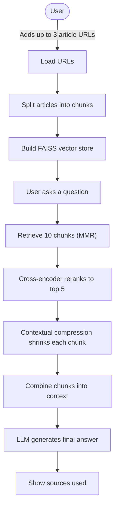

# News RAG Pipeline


A Streamlit app that answers questions about news articles using a full retrieval-augmented generation (RAG) pipeline: FAISS vector search with MMR, a cross-encoder reranker, and LangChain contextual compression, before generating a final answer with an LLM served through [OpenRouter](https://openrouter.ai).

## Features

- **Load up to 3 article URLs** — articles are scraped, split into chunks, and embedded into a FAISS vector store.
- **MMR retrieval** — retrieves the 10 most relevant and diverse chunks for a question using Maximal Marginal Relevance.
- **Cross-encoder reranking** — a `cross-encoder/ms-marco-MiniLM-L-6-v2` model reranks the 10 chunks and keeps the top 5.
- **Contextual compression** — each of the top 5 chunks is split into sentences and filtered down to only the pieces relevant to the question, shrinking the context sent to the LLM.
- **Transparent pipeline UI** — every step (retrieved chunks, reranked chunks, compressed chunks, final answer, sources) is shown in expandable panels.
- **Source attribution** — the final answer lists exactly which article URLs were used to generate it.

## Architecture



## Project Structure

| File | Description |
|------|--------------|
| `main.py` | Streamlit app — URL loading, FAISS indexing, retrieval, reranking, compression, and answer generation |
| `requirements.txt` | Python dependencies for the project |
| `.env.example` | Template showing which environment variables are required |
| `.gitignore` | Excludes `.env`, `.venv/`, the FAISS index, and other local/generated files from version control |

## Getting Started

1. **Clone the repo**
   ```bash
   git clone <repository-url>
   cd langchain-news-rag-pipeline
   ```

2. **Create a virtual environment**
   ```bash
   python3 -m venv .venv
   source .venv/bin/activate  # On Windows: .venv\Scripts\activate
   ```

3. **Install dependencies**
   ```bash
   pip install -r requirements.txt
   ```

4. **Set up environment variables**
   ```bash
   cp .env.example .env
   ```
   Then open `.env` and paste in your own OpenRouter API key.

5. **Run the app**
   ```bash
   streamlit run main.py
   ```

## Environment Variables

| Variable | Required | Description |
|----------|----------|-------------|
| `OPENROUTER_API_KEY` | Yes | Your API key for [OpenRouter](https://openrouter.ai), used to call the `openai/gpt-oss-120b` LLM and the `openai/text-embedding-3-small` embedding model. Create a free key at [openrouter.ai](https://openrouter.ai). |

> **Note:** OpenRouter requires account credits for most models to respond. If the pipeline fails to generate an answer, check that your OpenRouter account has sufficient credits.

## Example Questions

- What happened in the articles I loaded?
- Summarize the main event described in these sources.
- What did [a named person or organization in the articles] say or do?
- Are there any conflicting details between the loaded articles?

## A Note on API Keys

Your OpenRouter API key lives in `.env`, which is listed in `.gitignore` and **must never be committed** to version control. Only `.env.example` (with an empty placeholder) should be checked in.
